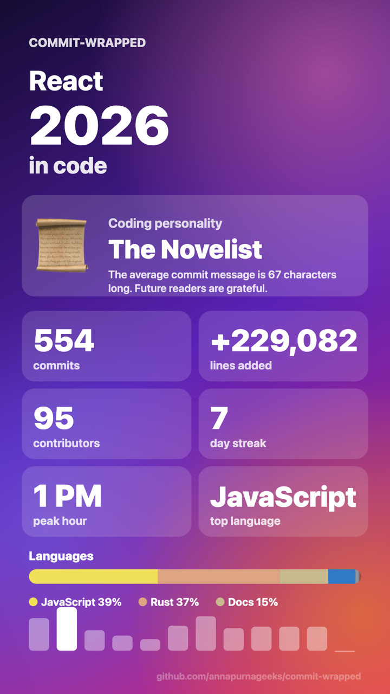

<div align="center">

# commit-wrapped

**Your year in code, as a story you can share. Like Spotify Wrapped, but for git.**

Your commits, streaks, night-owl hours, top languages, biggest commit and coding personality,<br>
as animated slides and a card made for Instagram, X and LinkedIn.<br>
One command. Runs on your machine. Nothing is uploaded. Zero dependencies.

[](https://github.com/annapurnageeks/commit-wrapped/actions/workflows/ci.yml)
[](#make-yours-in-10-seconds)
[](wrapped.py)
[](#privacy)
[](SKILL.md)
[](LICENSE)


&nbsp;&nbsp;


**[▶ Watch React's 2026 Wrapped](https://annapurnageeks.github.io/commit-wrapped/)** · [Flask's 2026](https://annapurnageeks.github.io/commit-wrapped/flask/)

</div>

---

## Make yours in 10 seconds

```bash
git clone https://github.com/annapurnageeks/commit-wrapped
python3 commit-wrapped/wrapped.py ~/code --open
```

Point it at the folder where you keep your projects. It finds every git repo inside, keeps **your** commits from this year (matched by your git name and email), and writes `wrapped.html`: a story you can tap through, then save as a 1080×1920 image to post.

Python 3.9+ and git. Nothing to install.

## What's in your Wrapped

| | |
|---|---|
| 🔢 **The big numbers** | Commits, active days, lines added and removed |
| 📅 **Your rhythm** | Month by month, day of the week, and a 24-hour clock of when you actually code |
| 🔥 **Streaks** | Your longest run of consecutive days, and your longest break |
| 🗓️ **The calendar** | Every day of the year, colored by how busy it was |
| 🧠 **Top languages** | What you really wrote, with lockfiles and generated code filtered out |
| 📄 **Obsessions** | The file you couldn't leave alone, and your top repos |
| 💥 **Biggest commit** | That one commit. You know the one. |
| 💬 **Commit messages** | Your favourite word, how often you wrote "fix", your shortest message |
| 🦉 **Coding personality** | Night Owl, Early Bird, Weekend Warrior, Firefighter, Minimalist, Explorer, Machine, Haiku Poet or Novelist, picked from your real habits |
| 📸 **The card** | One image with all of it: **Save image**, **Copy text** or **Post on X** |

**Controls:** tap or <kbd>→</kbd> next · <kbd>←</kbd> back · hold or <kbd>Space</kbd> to pause · <kbd>H</kbd> hide the controls (for screen recording) · `wrapped.html#5` opens slide 5.

## Let an AI write your captions (much better)

The built-in captions stick to the facts. An AI agent can dig into your history and make it personal: *"You rewrote the parser three times in March. Third time's the charm."*

commit-wrapped is an [agent skill](https://docs.claude.com/en/docs/claude-code/skills). Install it for Claude Code:

```bash
git clone https://github.com/annapurnageeks/commit-wrapped ~/.claude/skills/commit-wrapped
```

Then ask:

> make my coding wrapped for this year

The agent reads the facts (`--brief`), looks closer at the interesting parts, writes `captions.json`, and renders the story. [React's demo](https://annapurnageeks.github.io/commit-wrapped/) was made this way ([its captions](examples/react.captions.json)).

## A project's year

Wrap a whole project, every contributor included:

```bash
python3 wrapped.py path/to/project --everyone --name "My Project" --open
```

Great for a year-end post on your project's blog, or a thank-you to its contributors.

## Options

```
python3 wrapped.py [folders or repos...] [options]

  -o, --output FILE    where to write it (default: wrapped.html)
  --open               open it in your browser
  --year YEAR          which year (default: this one)
  --author NAME|EMAIL  who you are, if git config doesn't know (repeat for several)
  --name TEXT          the name on the story (default: your git user.name)
  --everyone           count every contributor: a project's year
  --private            hide repo names, file paths and commit messages
  --all-branches       also count commits that aren't on the current branch
  --brief              print the facts as JSON (for an AI, or your own scripts)
  --script FILE        your own captions (see SKILL.md for the format)
```

**Commits missing?** You probably committed under another email (a work address, or GitHub's `noreply` one). Find them with `git log --format='%aN <%aE>' | sort | uniq -c`, then add `--author` for each.

## Privacy

Everything runs locally. `wrapped.html` is one self-contained file: no tracking, no fonts or scripts from the internet, no API calls. It contains only the numbers you see in the story.

Working on closed-source code? `--private` replaces repo names with *Repo 1, Repo 2…* and leaves out file paths and commit messages, so the card is safe to post.

## How it works

`wrapped.py` is about 450 lines of plain, commented Python, and is easy to read:

1. **`find_repos()`** walks your folders looking for `.git` (skipping `node_modules` and friends)
2. **`read_commits()`** runs `git log --numstat` and keeps your commits from the year, using **your own local time** for each commit, so 2 AM means 2 AM where you were
3. **`build_facts()`** counts everything and picks your personality: each trait has a threshold, and the one you exceed by the most wins
4. **`render()`** drops the facts into `player.html`, which animates the story and draws the share card on a canvas

## Contributing

Ideas welcome, especially new slides, new personalities and new card designs. Run the tests with `python3 -m unittest discover tests`. Made a great Wrapped of an open-source project? Open an issue with a link, and the best ones go in the gallery.

Also by me: **[gitumentary](https://github.com/annapurnageeks/gitumentary)** turns any repo's history into a 2-minute animated documentary.

## License

[MIT](LICENSE)
